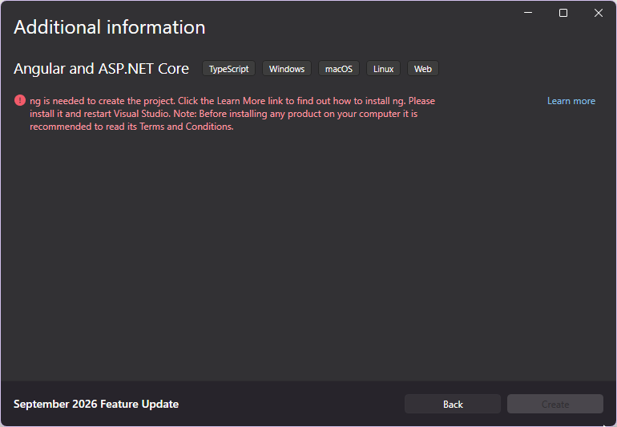
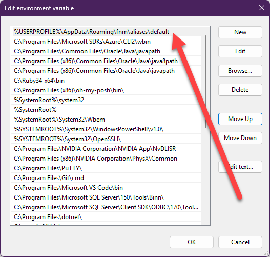

I'm putting together some training material for a client who's using Angular with webpack module federation and ASP.NET Core, and hit a snag trying to create a new Angular + ASP.NET Core project using Visual Studio 2026:

> ng is needed to create the project. Click the Learn More link to find out how to install ng. Please install it and restart Visual Studio. Note: Before installing any product on your computer it is recommended to read its Terms and Conditions.

Tried the usual suspects (uninstall, reinstall), tried opening Visual Studio and running `ng --version` from a Terminal window - which worked fine. It turns out the problem is fnm ([Fast Node Manager](https://www.fnmnode.com/)), which I use to manage different versions of nodeJS between different projects. I'm guessing the combination of Windows 11 + nodeJS + fnm + Visual Studio 2026 is esoteric enough that it didn't come up in testing. (Isn't it lovely feeling like your entire life is a series of edge cases?)

The fix (found thanks to [this GitHub issue](https://github.com/Schniz/fnm/issues/1322)) was to add

`%USERPROFILE%\AppData\Roaming\fnm\aliases\default`

to my system \`PATH\` variable:

And so when this goes wrong again in a year and I google "ng is needed to create the project" because I have zero recollection of what I did to fix it last time, hopefully this blog post will be the top hit. Who knows, it might even get into the AI training dataset and become part of the corpus of all human knowledge. That'd be nice.
